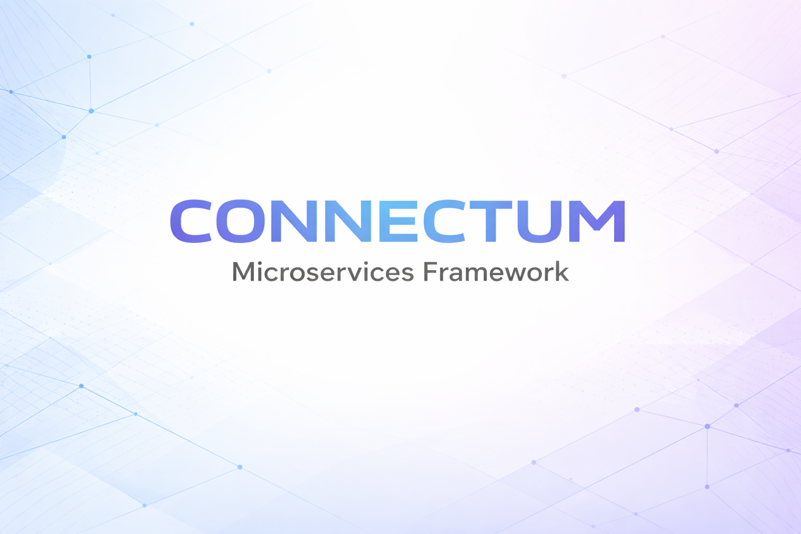

<div align="center">

<a href="https://connectum.dev">
<picture>
  <source media="(prefers-color-scheme: dark)" srcset="../assets/splash-dark.png">
  <source media="(prefers-color-scheme: light)" srcset="../assets/splash.png">
  
</picture>
</a>

<br>

**Production-ready gRPC / ConnectRPC microservices for Node.js, with Protocol Buffers as the single source of truth**

<br>

[](https://github.com/Connectum-Framework/connectum/actions/workflows/ci.yml?query=branch%3Amain)
[](https://www.npmjs.com/package/@connectum/core)
[](https://www.npmjs.com/package/@connectum/core)
[](https://github.com/Connectum-Framework/connectum/releases/latest)
[](https://connectum.dev/en/guide/runtime-compatibility)
[](https://github.com/Connectum-Framework/connectum/blob/main/LICENSE)
[](https://buf.build/connectum-framework/connectum)

[Quickstart](https://connectum.dev/en/guide/quickstart) ·
[Documentation](https://connectum.dev) ·
[Examples](https://github.com/Connectum-Framework/examples) ·
[Roadmap](https://github.com/orgs/Connectum-Framework/projects/1) ·
[Discussions](https://github.com/Connectum-Framework/connectum/discussions)

</div>

&nbsp;

## What Connectum is

Connectum is a set of modular packages for building gRPC and ConnectRPC services in TypeScript. You describe a service in a `.proto` file; the server, the typed clients, the event topics, the authorization rules and the service catalog follow from that contract. There is no hidden layer between your code and the platform, and you bring your own database, ORM and message broker.

```typescript
import { createServer } from '@connectum/core';
import { Healthcheck } from '@connectum/healthcheck';
import { Reflection } from '@connectum/reflection';
import { createDefaultInterceptors } from '@connectum/interceptors';

const server = createServer({
  services: [routes], // your ConnectRPC routes
  port: 5000,
  protocols: [Healthcheck({ httpEnabled: true }), Reflection()],
  interceptors: createDefaultInterceptors(),
});

await server.start();
```

&nbsp;

## What you get

| | |
|---|---|
| :electric_plug: **Server** | `createServer()` with lifecycle events, TLS, graceful shutdown and pluggable protocols (health check, reflection) |
| :shield: **Interceptors** | Error handling and request validation by default; timeout, retry, circuit breaker, bulkhead and fallback when you opt in |
| :closed_lock_with_key: **Auth** | JWT, gateway and session authentication, declarative RBAC, authorization declared in the proto |
| :incoming_envelope: **Events** | A proto-first `EventBus` with retry and dead-letter middleware, and adapters for NATS JetStream, Kafka / Redpanda, Redis Streams / Valkey and AMQP / RabbitMQ |
| :bar_chart: **Observability** | OpenTelemetry tracing, metrics and logs through one `initProvider()` |
| :jigsaw: **Service catalog** | A typed `ctx.call()` between services, generated from your protos by a Buf plugin |
| :test_tube: **Testing** | An in-process server and client for tests that open no socket, plus mock contexts and resolvers |

Every package is published on npm under `@connectum/*`, and the contracts are published to the [Buf Schema Registry](https://buf.build/connectum-framework/connectum). Node.js and Bun are exercised in CI; the [compatibility matrix](https://connectum.dev/en/guide/runtime-compatibility) lists what is supported where.

&nbsp;

## Repositories

| Repository | What it is |
|---|---|
| [**connectum**](https://github.com/Connectum-Framework/connectum) | The framework: 15 packages in one pnpm workspace. Issues, releases and the changelog live here. |
| [**docs**](https://github.com/Connectum-Framework/docs) | Sources of [connectum.dev](https://connectum.dev): guides, package pages, architecture decision records and the generated API reference. |
| [**examples**](https://github.com/Connectum-Framework/examples) | Runnable services: a getting-started project, an HRIS and a car-sharing system, event-bus setups for each broker, and a performance test server. |
| [**protobuf-es**](https://github.com/Connectum-Framework/protobuf-es) | A fork of [bufbuild/protobuf-es](https://github.com/bufbuild/protobuf-es), Protocol Buffers for ECMAScript. |

&nbsp;

## Principles

1. **Minimalist.** Only essential abstractions; nothing sits between you and the platform.
2. **Cloud native.** Built for Kubernetes, service meshes, zero trust and identity providers from the first line.
3. **Contract first.** Protocol Buffers, gRPC and ConnectRPC are first-class; the contract drives the code, not the other way round.
4. **Separation of concerns.** Each package does one thing, and the layers between packages are documented.
5. **Non-opinionated.** No forced ORM, broker or logger. Bring Kafka, NATS, Prisma or Drizzle.

&nbsp;

## Get involved

- **Use it:** start with the [quickstart](https://connectum.dev/en/guide/quickstart), then read the [example](https://github.com/Connectum-Framework/examples) closest to your case.
- **Ask or propose:** open a [discussion](https://github.com/Connectum-Framework/connectum/discussions); report a bug or a documentation gap as an [issue](https://github.com/Connectum-Framework/connectum/issues/new).
- **Contribute:** read [CONTRIBUTING.md](https://github.com/Connectum-Framework/connectum/blob/main/CONTRIBUTING.md) and the [development setup](https://connectum.dev/en/contributing/development-setup). Planned work is on the [project board](https://github.com/orgs/Connectum-Framework/projects/1).

&nbsp;

---

<div align="center">

**Apache 2.0** — Built with love by [Highload.Zone](https://highload.zone)

</div>
